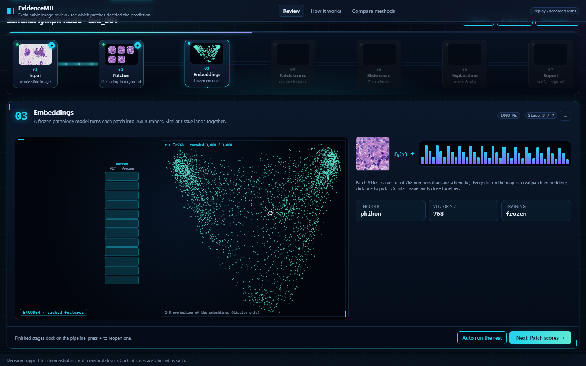
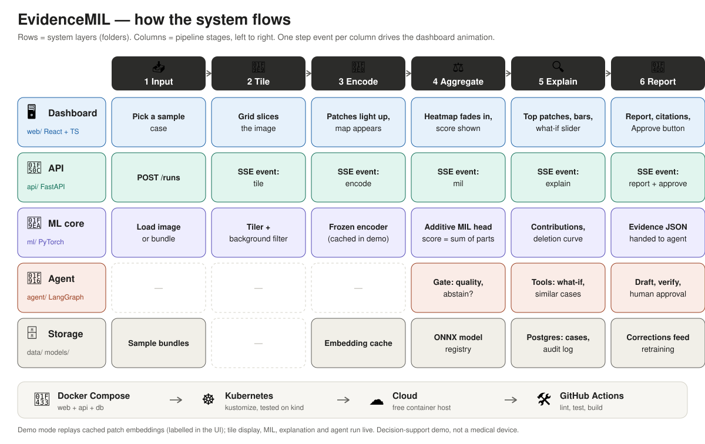

# EvidenceMIL

**See why the model decided.** EvidenceMIL reads a huge medical image as a bag of small patches, scores it,
and shows exactly which patches produced the score. A reviewer can check the evidence, test it ("what if
these patches were absent?"), and sign off a report whose every number has been verified.

**Live demo:** https://ubaidur404786.github.io/evidence-mil/ (recorded runs on real CAMELYON16 slides, no backend needed)

> Decision support for demonstration, not a medical device.



The dashboard plays the forward pass left to right: each stage computes, zooms out of its node, animates what it
does with the real numbers (tiling, encoding, per-patch scores, the running sum of evidence, the heatmap, the
verified report), then docks back into the pipeline, where **+** reopens it. More frames: `docs/screens/`.

## The problem
A pathologist checking a lymph node for breast-cancer metastasis looks at a slide of about 100,000 × 200,000
pixels. The tumour can be a few hundred cells. AI can flag such slides, but a bare "tumour: 97%" is hard to trust.
Older systems that also show *where* (segmentation networks such as U-Net, or the patch classifiers that won
CAMELYON16) need pathologists to outline every tumour region by hand for training, which is slow and costly.

EvidenceMIL learns from the slide label alone ("this slide has tumour") and still points to the tumour, with a
heatmap that is the score itself, not an after-the-fact guess.

## How it works


| step | what happens | what the reviewer sees |
|---|---|---|
| 1. Input | a whole-slide image (or an uploaded region) | the slide |
| 2. Tile | 224 px patches at 20× (≈ 112 µm); background dropped | the tile grid |
| 3. Encode | a frozen pathology model (Phikon) turns each patch into 768 numbers | embedding map |
| 4. Aggregate | our **additive MIL head** scores each patch; slide score = Σ patch contributions + bias, then calibrated | probability, abstain band |
| 5. Explain | contributions are exact: top patches, bars that add up to the score, deletion test | heatmap, patch gallery, what-if curve, agreement with the pathologist |
| 6. Report | an agent drafts a report; a verifier rejects any number or patch id not in the evidence; a person approves | report with clickable citations |

If the calibrated probability falls in the uncertainty band (35–65%), the system **abstains** and refers the
case to a specialist instead of guessing.

## Results on real slides
**Slide-level accuracy, full CAMELYON16 test set** (130 slides; frozen Phikon features; mean ± sd over 3 seeds;
`results/cache_phikon_results.md`):

| method | training labels | slide AUROC |
|---|---|---|
| mean pooling | slide label | 0.579 ± 0.010 |
| attention MIL (ABMIL) | slide label | 0.920 ± 0.008 |
| **additive MIL (ours)** | slide label | **0.911 ± 0.012** |
| CAMELYON16 winner, Wang et al. 2016 (published, not reproduced) | pixel outlines | 0.925 |

**Finding the tumour, compared with older approaches** (5 real test slides tiled by us, same tiles and features
for every method, scored against the pathologists' outlines; `results/c16_comparison.md`):

| method | training labels | slide decisions: correct / abstained / wrong | localisation AUROC | top-10 patches inside outline |
|---|---|---|---|---|
| **additive MIL (ours)** | slide label | **4 / 1 / 0** | 0.958 | 90% (chance 4%) |
| attention MIL | slide label | 4 / 0 / 1 | 0.984 | 92% |
| supervised patch classifier (U-Net / CAMELYON16-winner family) | pixel outlines | 4 / 0 / 1 | 0.963 | 82% |
| mean pooling | slide label | 1 / 1 / 3 | — | — |

What this shows: without a single drawn outline, EvidenceMIL localises the tumour about as well as a classifier
trained on pathologist outlines; it is the only method that does not raise a false alarm on the normal slide (it
abstains); and its heatmap is the exact decomposition of its score, while attention weights are unsigned and do
not add up to the prediction. Five slides is prototype scale: read the differences as indicative.

## Run it
Requirements: [uv](https://docs.astral.sh/uv/), Node 22. The toy pack runs on any CPU laptop.
```bash
uv sync --all-packages --all-extras
uv run python scripts/build_demo.py      # toy model + demo cases + recorded runs (< 1 min)
EVIDENCE_PACKS=data/packs.json uv run uvicorn evidence_api.main:app_factory --factory --port 8000
cd web && npm ci && npm run dev          # http://localhost:5173 — Review, How it works, Compare methods
```
Real slides and uploads (CAMELYON16 pack, GPU recommended): see [docs/RUNBOOK.md](docs/RUNBOOK.md) §1.
No backend? `cd web && npm run build && npx vite preview`, open `/?replay`. Docker: `docker compose up --build`.
Tests: `uv run pytest contracts ml agent api` and `cd web && npm test && npx playwright test`.

## Engineering
- Modular monolith: `ml/` (PyTorch library), `agent/` (LangGraph), `api/` (FastAPI, SSE, uploads), `web/`
  (React + TypeScript review workstation), all typed through one schema in `contracts/` (JSON Schema → pydantic + TS).
- Tests in every module: additivity property tests, ONNX parity, slide-geometry and annotation tests, agent
  abstain/reject/approve paths, SSE order, upload → live encode → run, OpenAPI matches contracts, Playwright replay.
- Docker (multi-stage, non-root), Kubernetes (kustomize, kind and cloud overlays), GitHub Actions CI, GitHub Pages demo.
- Decisions: [docs/DECISIONS.md](docs/DECISIONS.md) · data and model licences: [docs/DATA.md](docs/DATA.md).

## Limits
- Decision-support prototype, not a medical device; not clinically validated.
- Localisation comparison uses 5 slides. Slide-level numbers use the full 130-slide test set.
- The head was trained on Owkin's precomputed Phikon features; demo slides and uploads use live Phikon features
  of our own tiling (DECISIONS ADR-014). Uploads assume 20× magnification.
- Phikon and its features are non-commercial (Owkin licence); CAMELYON16 images are CC0.

## Acknowledgements
Built with assistance from Claude (Anthropic) for code and documentation drafting. Design decisions, experiments
and review by the author. CAMELYON16 organisers (Radboud UMC, UMC Utrecht) for the CC0 slides and annotations;
Owkin for Phikon and the CAMELYON16 features; DINOv2 (Meta AI, Apache-2.0).
