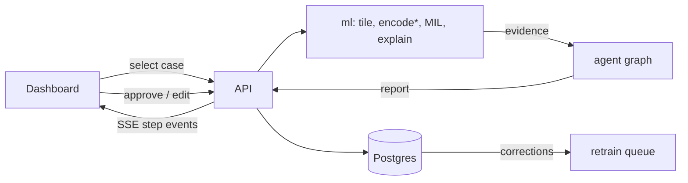

# Architecture

Visual: [`architecture.svg`](architecture.svg) (rows = system layers, columns = pipeline stages).

## 1. Idea in one paragraph
A large image is a **bag** of small **patches**. A frozen, pretrained image encoder turns each patch
into a vector. A small **additive MIL head** reads the bag and outputs one case-level score.
Because the score is a sum of per-patch contributions, the explanation is exact, not approximate.
An agent then turns the evidence into a checked report that a human approves.

## 2. Pipeline (the 6 columns in the diagram)
| # | Stage | What happens | Event payload (contracts) |
|---|---|---|---|
| 1 | Input | choose a case / upload an image | `thumbnail` (JPEG data URL), `overlay` (annotation RGBA PNG or null), `title`, `domain`, `source`, `note`, `reference_label`, `image_size` |
| 2 | Tile | cut into a grid of patches, drop background | `rows`, `cols`, `coords` [[row, col]], `n_patches`, `tile_um`, `reference` (per-patch annotated-tumour fraction or null) |
| 3 | Encode | frozen encoder → vector per patch (cached for demo slides, live for uploads) | `encoder`, `dim`, `projection` (2-D PCA), `cached` flag |
| 4 | Aggregate | additive MIL head → logit, calibrated probability, abstain flag | `logit`, `bias`, `probability`, `temperature`, `abstain`, `abstain_band`, `attention` |
| 5 | Explain | contributions (sum = logit), top-k, deletion curve, agreement with annotation | `evidence` (contract `Evidence`), `patch_images` (top 8 as data URLs), `localisation` (precision@k, chance, AUROC or null) |
| 6 | Report | LangGraph: gate → tools → draft → verify → human approval | `report` (contract `Report`) |

The API streams one `StepEvent` per stage (SSE). The dashboard animates each event as it arrives,
or replays a recorded event file (offline-safe demo mode).

**Dashboard** (`web/`): worklist (filter by review status) → case workspace: slide viewer (zoom/pan,
layers: tiles / attention / contribution / pathologist outline, click a tile to inspect it), pipeline bar
(replays the six stages), side panel (score + abstain band, contribution bars summing to the logit,
top-patch gallery, what-if deletion curve, agreement with the pathologist, report sign-off). Uploads (live
mode) are tiled and encoded on the server and appear in the worklist.

**Packs** (`api/packs.py`): a pack = trained head + its cases + optional live encoder. `toy` (fake encoder)
and `c16` (Phikon, CAMELYON16). Configured with `EVIDENCE_PACKS` (written to `data/packs.json` by
`scripts/build_demo.py`).

## 3. Layers (the rows in the diagram) = folders
| Layer | Folder | Depends on | Notes |
|---|---|---|---|
| Contracts | `contracts/` | nothing | JSON Schema → pydantic + TS types. Single source of truth. |
| ML core | `ml/` | contracts | tiling, encoders, MIL heads, explain, train/eval, ONNX export. No web code. |
| Agent | `agent/` | contracts | LangGraph review graph, LLM adapter, verifier. |
| API | `api/` | ml, agent, contracts | FastAPI, thin. Case store, SSE, auth-less demo mode. |
| Dashboard | `web/` | contracts (via API) | React + TS step-by-step animated player. |
| Deploy | `deploy/` | built images | Docker Compose, Kubernetes (kustomize), CI in `.github/`. |

**Monolith or microservices?** Modular monolith: one backend container (`api` imports `ml` and `agent`
as libraries) + web + database. Reason: small team, one model, no independent scaling need. The module
boundaries above make a later split (e.g. a separate inference service) a mechanical change.

## 4. Model design
- `Encoder.embed(patches) -> Tensor[N, D]` behind a registry; swap via config. Frozen. See ADR-001.
- `MILHead.forward(bag[N, D]) -> {logit, contributions[N], attention[N]}`.
- Heads: `mean` and `abmil` (baselines), `additive` (ours).
  Additive: `a = softmax(gated_attention(h))`, `e_i = a_i * (w · h_i)`, `logit = Σ e_i + b`.
  Property tested in CI: `sum(contributions) + b == logit`.
- Calibration: temperature scaling. Abstain when probability is inside a confidence band (conformal later).
- What-if: remove top-k patches by contribution, re-run the head, return the probability curve.
- Faithfulness checks: deletion/insertion curves, random-weight sanity check, localisation vs masks.

## 5. Agent (LangGraph)
`gate (quality + abstain)` → `tools (what-if, similar cases)` → `draft (LLM or template)` →
`verifier (every number and patch id must exist in the evidence)` → `human interrupt (approve/edit)`.
LLM adapter: `template` (default, no LLM) · `local` · `hosted` (open-data demo only).
The LLM never makes the prediction; it only words the verified evidence.

## 6. Data flow at runtime

`*` demo mode uses cached embeddings, labelled as such in the UI.

## 7. Target folder tree
```
evidence-mil/
├─ CLAUDE.md  README.md  .gitignore
├─ docs/            ARCHITECTURE.md  DECISIONS.md  ROADMAP.md  DATA.md  DEMO_SCRIPT.md  architecture.svg
├─ contracts/       schemas/*.json  generated/{python,ts}
├─ ml/
│  ├─ src/evidencemil/{data,encoders,mil,explain,pipeline}/
│  ├─ configs/      *.yaml          # encoder, head, train settings
│  └─ tests/
├─ agent/           src/evidence_agent/{graph,tools,llm,verify}.py   tests/
├─ api/             src/evidence_api/{main,routes,events,store}.py   tests/
├─ web/             src/{components,steps,hooks}/   tests/
├─ deploy/          docker/  k8s/{base,overlays/{local,cloud}}
├─ scripts/         dev helpers (run, extract-embeddings, record-demo)
├─ results/         metrics tables + figures (raw outputs ignored)
├─ data/            (ignored) samples, embeddings
└─ .github/workflows/
```
